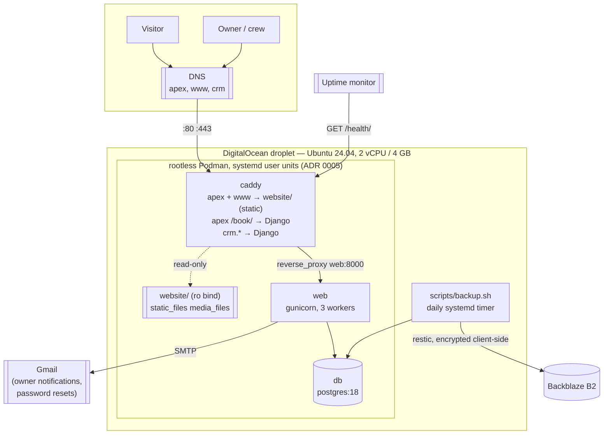

# VPS deployment and website plan

**Planning only.** No code, configuration, infrastructure or DNS was
changed in producing this document. Dated 2026-10-27, against `main` at
`38e9e31`, building on `docs/VPS_AUDIT.md` (session 1).

Labels used throughout: **Verified** (checked, with `path:line` or a
source and date), **Recommendation** (my proposal, open to being
overruled), **Assumption** (reasoned, not proven), **Open** (needs the
owner or a machine this session does not have). Priorities are the
audit's: **P0** before the CRM holds real data, **P1** before the
public website launches, **P2** recommended, **P3** future.

Nothing here is a decision already taken. Where I recommend something,
the simpler alternative I rejected is named so it can be chosen
instead.

---

## 0. Decision log

**2026-10-27 — the owner accepted every recommendation in §4** ("run
all recommendations"). They are decisions from here, and the sections
below keep their reasoning and their rejected alternatives so a later
session can see what was weighed rather than only what was chosen.

| | Decided |
|---|---|
| D1 | The booking form is served by Django at `/book/` on the website's own origin, via Caddy path routing. No API, no CORS, no DRF |
| D2 | A submission creates a `Contact` (`status=lead`, `lead_source=website`), a `Property` when an address is given, a follow-up `Task`, and a change-log entry — authored by a seeded `website` service account with an unusable password, **not** by making `created_by` nullable |
| D3 | Required: name, phone, service address, service wanted. Optional: email, description, contact method, preferred date |
| D4 | Honeypot + minimum submit time + per-IP limit on Django's database cache. No CAPTCHA at launch |
| D5 | No uploads on the public form at all |
| D6 | The website lives in `website/` in this repository — structure, shared partials, mounts, deploy, CI filter and the private-data guard are all in D6 |
| D7 | Two Caddy site blocks, new `CRM_HOST` and `WEBSITE_HOSTS` variables, a shared header snippet, `templates` for the partials, website images under `/assets/` |
| D8 | No change to the layout: `~/django-crm`, per ADR 0005 |
| D9 | Gmail SMTP on the existing free account, owner notifications only, no new DNS records |
| D10 | Booking availability stays in phase 8, behind business hours, service durations and a capacity rule |

**Nothing in this plan depends on retired or unfinished work.**
Phases 20, 21 and 22 are complete on `main` (`docs/ROADMAP.md`), and
team messaging was retired code-only in Phase 21 (ADR 0014), so no
unit here plans invoicing or messaging work or relies on the messaging
models. Phase 8's money item is not Phase 20 work: it is the separate
gap that a mistyped payment cannot be corrected in the app (audit
F-CRM-4).

**Still open, and not changed by this acceptance** — the seven
questions in §13. Two of them can alter work already decided:
whether Wix permits the apex edit (§7's Path A or Path B), and whether
a full address is required on the form (D3). Neither blocks phase 1.

---

## 1. Executive summary

The CRM is architecturally ready for a DigitalOcean droplet. What is
not ready is the handful of things a real business needs around it:
accounts it can create itself, a way back in when somebody forgets a
password, mail of any kind, a restore that has actually been run, and
a web server configured for more than one site.

The plan is eight phases. The first three get the **CRM** live on
`crm.heffronexteriorservices.com` with real data, backups and a proven
restore — and none of them touch the website, the apex domain or Wix,
so none of them can take the business offline. Only phases 4-6 involve
the public site, and only phase 6 touches DNS the public uses. Phase 7
retires RevDek and Wix once everything that replaces them is running.

Three things shape the whole sequence:

1. **The CRM can go live without any DNS risk.** One new `crm` A
   record, while Wix keeps serving the website exactly as it does
   today. Do this first and the rest is unhurried.
2. **The domain is registered *and* DNS-hosted at Wix** (audit §8), so
   Wix cannot be cancelled until at least the DNS, and ideally the
   registration, has moved. This is the longest-lead item and the one
   that can take the business offline if done in the wrong order.
3. **Three of the audit's five P0 blockers are one piece of work.**
   User creation, password reset and outbound email are a single
   feature with email underneath it, not three separate tasks.

Estimated **35-60 hours of code time** and **8-16 hours of owner
time**, spread over as many weeks as suits. Running cost lands around
**$29-34/month** against RevDek's $85 plus Wix (§11).

---

## 2. Recommended final architecture



Unchanged from today: three containers, rootless Podman, systemd user
units, `~/django-crm`, restic to B2. New: a second Caddy site, a
`website/` directory, SMTP, and a monitor.

---

## 3. RevDek gap analysis

The owner's statement (2026-10-27): *"revdek features that are being
used are already built within the CRM application, no payments will be
made using the crm or website, no sms reminders, etc."*

| RevDek capability | This CRM | Priority |
|---|---|---|
| Customer records, leads | **Exists** — `Contact` with `status`, `lead_source`, tags, addresses | — |
| Scheduling / calendar | **Exists** — day/week/month, crew assignment, drag to reschedule, click-to-book | — |
| Quotes / estimates | **Exists** — `Quote` with lines, statuses, estimate→job | — |
| Invoicing | **Exists** — kept for customers who ask; ADR 0013 made the job the money record | — |
| Payments recorded | **Exists** — on the job (ADR 0013). *Cannot be corrected in-app* (audit F-CRM-4) | P1 |
| Card payments / processing | **Not built, and not wanted** — owner's decision | — |
| SMS reminders | **Not built, and not wanted** | — |
| Online booking (instant) | **Not built.** A request form is phase 5; true availability is phase 8 | P3 |
| Review requests | **Not built** | Open |
| Customer portal | **Not built** | Open |
| Crew time tracking / payroll | **Exists** — time clock, payroll, per-person working days and rates | — |
| Photos on jobs | **Exists** — re-encoded, metadata stripped | — |
| Reporting | **Exists** — Financials, Profit, Performance, goals | — |

**Gate before cancelling RevDek (phase 7):** the owner confirms, after
using the CRM on real data for at least a full billing cycle, that
nothing in the left column is still being used there. Two rows above
are **Open** rather than cleared — review requests and a customer
portal — because they were not in the owner's list but are common
RevDek features; if either is in use, it needs a decision before
cancellation, not after.

---

## 4. Design decisions

### D1 — How the website form reaches the CRM

**Recommendation: same-origin path routing.** Caddy serves the static
site on the apex and sends only `/book/` to Django, which renders and
processes the booking request at
`heffronexteriorservices.com/book/`. (`/book/` is the owner's naming,
adopted here.) `contact.html` stays static — a phone number, a
`mailto:` fallback and a link to `/book/` — which keeps the proxied
surface to exactly one path.

Why: Django's ordinary CSRF protection works unchanged, there is no
API, no CORS, no cross-site cookie problem and no Django REST
Framework (audit fact 2 — DRF is deliberately absent). The form is
server-rendered like every other page in this project.

Simpler alternative considered and rejected: a static form POSTing to
`crm.heffronexteriorservices.com`. That is cross-origin, so it needs
`CSRF_TRUSTED_ORIGINS` for the apex, CORS headers, and a cookie that
survives a cross-site POST — three mechanisms to get right instead of
zero, for no gain.

**Consequence that must be handled in the same change:** the apex and
`www` have to join `ALLOWED_HOSTS`
(`config/settings/production.py:9-11`), and the Caddyfile takes its
single site address from that same variable
(`Caddyfile:16`, **Verified**). Both halves change together — see D7.

**Two details not to miss.** The form page must be served its CSS, so
the apex block needs its own `/static/*` handler, not just the proxy.
And the form template must **not** extend the CRM's `base.html`: that
renders the signed-in navigation, which links to login-required pages
and advertises the CRM's structure to the public. A minimal public
template, styled with the website's own CSS (D6.2).

### D2 — What a submission creates

**Recommendation:** one `Contact` with `status=lead` and
`lead_source=website` (**Verified** both values exist:
`apps/crm/models.py:65`, `:70`), plus a `Property` if an address was
given, plus one `Task` for the owner to call them back, plus a
change-log entry via `apps/crm/audit.py:27`. Never a `Lead` model —
retired in ADR 0012.

**The detail the audit did not surface, and it blocks this phase until
decided: `Contact.created_by` is non-null and `PROTECT`**, as are
`Task.assigned_to` and `Task.created_by` (**Verified** by
introspection, 2026-10-27). A public submission has no signed-in user,
so somebody has to be named as the author.

- **Recommendation:** seed a dedicated service account (username
  `website`) with an unusable password and no role group, and record
  it as `created_by`. The change log then reads "created by website",
  which is true and legible, and the account cannot sign in.
- Rejected: making `created_by` nullable. It would weaken the audit
  trail for every record in the system to accommodate one entry point.
- **Open:** who the follow-up `Task` is assigned to. Simplest rule is
  "the single user in the Owner role"; that needs a decision if there
  is ever more than one.

### D3 — Form fields

**Recommendation** — required: first name, last name, phone, service
address (street, town, state, postal code — all four, because
`Property` requires all four and has no defaults, **Verified**), and
which service they want. Optional: email, what they need doing,
preferred contact method, preferred date.

Phone required rather than email because this is a phone-first trade
and because duplicate detection matches on name, email **or** phone
(`apps/crm/duplicates.py:50`) — a lead with neither is unmatchable.

**Open:** whether a full address should be required at the request
stage. It is the single biggest deterrent on the form, and the
alternative is to ask only for a town and collect the address on the
call. I lean to requiring it (an exterior quote is address-specific),
but it is a business judgement.

### D4 — Spam and rate limiting, without Redis

**Recommendation**, in this order:

1. A **honeypot** field, hidden from people, rejected if filled.
2. A **minimum submit time** (a signed timestamp in the form; a
   submission under ~3 seconds is a bot).
3. A **per-IP rate limit on a shared backend.** Django's default cache
   is per-process locmem and gunicorn runs 3 workers (**Verified**:
   no `CACHES` setting; `Containerfile:35`), so a naive limiter counts
   a third of the traffic. Use Django's built-in
   `django.core.cache.backends.db.DatabaseCache` with
   `createcachetable` — a table, no new service.

**CAPTCHA: not at launch.** Cloudflare Turnstile would be the pick if
one is needed, but it means third-party JavaScript, and "zero
third-party JavaScript" is exactly what lets this project's CSP stay
at `default-src 'none'` with no `unsafe-inline`
(`config/settings/production.py:66-84`, **Verified**). Spending that
property before there is any spam is the wrong trade. Revisit as P2 if
spam actually arrives.

### D5 — Photos on the public form

**Decided by the owner: none.** Only the owner and website admin
publish photos. The public form accepts no uploads at all, which
removes the whole class of risk. The existing pipeline
(`apps/jobs/photos.py:64` — re-encode, strip metadata, cap size,
pixels and edge) stays for staff and is ready if that ever changes.

### D6 — The website lives in this repository

**Decided: a top-level `website/` folder in this repo**, not a second
repository. One deploy, one history, one backup, and CI can check it.
The cost is that a typo in the copy goes through a PR — acceptable, and
arguably correct for a public site.

#### D6.1 Folder structure

```
website/
  index.html          home
  services.html
  gallery.html        the business's own work only (D6.6)
  contact.html        phone, hours, a mailto: fallback, a link to /book/
  404.html            served by Caddy's handle_errors
  robots.txt
  sitemap.xml
  partials/
    header.html       ONE copy, read by both Caddy and Django (D6.2)
    footer.html
  assets/
    css/site.css      ONE stylesheet, serving the static pages and /book/
    js/site.js        optional, progressive
    img/              owner-supplied photos, metadata stripped
    icons/
```

Under `assets/`, never `media/` — a `/media/*` handler on the website
would trip the private-media ordering guard, for the reason D7 gives.

#### D6.2 How `/book/` shares the CSS, header and footer

The Django-rendered booking page must look like the site, and the way
it usually goes wrong is three copies of a header that drift apart.
One copy of each, read by both engines:

- **CSS: nothing to share.** The `/book/` template links
  `/assets/css/site.css` — an absolute path on the *same origin*,
  served by Caddy out of `website/assets/`. No `collectstatic` copy, no
  second stylesheet, no import. Django's own `/static/` keeps serving
  the CRM's CSS; the public page simply does not use it.
- **Header and footer: one file each in `website/partials/`.**
  - Django reads them directly: add `BASE_DIR / "website"` to
    `TEMPLATES["DIRS"]`, then ``.
  - The static pages read the same files through Caddy's built-in
    `templates` directive: `{{include "/partials/header.html"}}`.
  - The partials stay **plain HTML with no template syntax of either
    flavour**, so each engine treats them as text. A test asserts they
    contain neither `{%` nor `{{`, because the day one of them does,
    one of the two renderings breaks silently.
  - `templates` is scoped to HTML, so a `{{` inside a `.js` asset is
    never evaluated.
  - The "current page" highlight is a ten-line progressive script that
    sets `aria-current` from `location.pathname`; with the script
    blocked the nav still works, it just does not highlight.

Simpler alternative considered and rejected: duplicate the header
markup into every static page and again into the Django template.
Three copies, and the one that drifts is the `/book/` page looking
subtly unlike the site — exactly the failure this is meant to avoid.

**To verify:** `caddy adapt` accepts `templates` (it is a standard
directive in the official image, not a plugin — CI proves it rather
than trusting it); a Django test asserts the rendered `/book/` page
contains a string that exists only in the partial; and the no-template-
syntax test above.

#### D6.3 Mounting it into Caddy — **both** compose files

```yaml
caddy:
  volumes:
    - ./website:/srv/website:ro,Z
```

- `:ro` because Caddy only ever reads it. `:Z` for the same SELinux
  reason as the existing Caddyfile mount
  (`compose.prod.yml:75-81`) — and audit finding F-VPS-3, the question
  of how `:Z` behaves on Ubuntu, applies to this mount identically.
- **`compose.dev.yml` too**, for two reasons: the proxy-config tests
  assert against `Caddyfile` *and* `Caddyfile.dev`
  (`apps/jobs/tests/test_private_media.py:425`), so both configs have
  to be real; and a dev stack that cannot serve the site makes local
  review impossible.
- Because it is a bind mount, the content is whatever the checkout
  holds — no image rebuild and no container restart for a copy change.

#### D6.4 Deploy and rollback

`scripts/deploy.sh` already does the work: it refuses a dirty tree
(`:56-57`), records the current HEAD as `previous` (`:175`), fetches,
and checks out the requested ref (`:178-185`). Website content
therefore ships by exactly the same mechanism as code, with no second
path to maintain.

**Recommendation:** add a `--website-only` fast path that checks out
the ref and skips `podman-compose build web` and the stack recreation,
because the Django image is not involved in a copy change. Its
verification step is a request to the apex, not the container health
check. Without it, fixing one word costs a full image rebuild.

**Rollback** is the same two commands as any other change: deploy the
previous ref, or `git revert` and deploy. The bind mount means the old
content is live the moment the checkout completes.

#### D6.5 CI, without breaking the required checks

**The trap:** adding `paths-ignore` to the workflows would stop `test`
and `dependency-audit` from running on a website-only PR — and GitHub
treats a required check that did not run as *unsatisfied*, not as
passed. The PR would sit at "Expected — waiting for status to be
reported" forever.

**Recommendation:** keep both workflows triggering on every path and
branch *inside* the job, so the check names always report.

1. An early step computes whether anything outside `website/` changed:
   `git diff --name-only origin/${{ github.base_ref }}...HEAD`.
2. The expensive steps (migrate, the Django suite, the audit) become
   conditional on that.
3. A website-only PR instead runs the cheap, relevant set: the
   private-data guard (D6.6), HTML validity, and a relative-link
   check — under the same `test` check name, so the gate stays
   meaningful rather than rubber-stamped.

**Never short-circuit** when `.github/**`, `requirements.txt`,
`Caddyfile*`, `compose*.yml` or `website/partials/**` changed. The last
one matters: the partials are consumed by Django, so a change there
can break the `/book/` page and must run the full suite.

Rejected: `dorny/paths-filter`. It works, but it puts a third-party
action in the critical path of a required status check for something
two lines of `git diff` already do.

#### D6.6 Keeping private data out of `website/`

**This repository is public** (**Verified**: `JosephHeffron/django-crm`
is PUBLIC), so anything committed here is published, including in the
history after a later deletion.

Already guarded by pre-commit (**Verified**
`.pre-commit-config.yaml:23`, `:30`): oversized files
(`check-added-large-files`) and private keys (`detect-private-key`).

**The real exposure is not covered: a photo of a customer's house
carries their address in its EXIF GPS tags.** That is precisely why
ADR 0009 and `apps/jobs/photos.py` exist — but website images bypass
that pipeline entirely, because they are *committed*, not uploaded.

**Recommendation: a test**, so CI enforces it on every PR including
website-only ones, walking `website/` and failing on:

1. **any image carrying EXIF at all** — not just GPS — read with
   Pillow, already a dependency;
2. **any file whose extension is not on a short allow-list**
   (`.html .css .js .svg .png .jpg .jpeg .webp .woff2 .ico .txt .xml
   .webmanifest`). This is what stops a `.csv` of customers, a `.pdf`
   invoice, a `.sql` dump or a stray `.env` from ever landing here;
3. **any file over a size cap** — an un-resized original is both a
   leak risk and a slow page.

When it fails, the fix is to run the image through the existing
re-encode path, which strips metadata and caps the long edge
(`apps/jobs/photos.py:103-110`).

**The rule the ADR should state in words, because a test cannot
express it:** photos in `website/` are of *the business's own work*,
published deliberately. A customer's name, address, or anything
identifying them does not belong in this folder — the gallery shows
work, not clients — and reference screenshots of the CRM never do.

### D7 — Caddy for two sites

**Recommendation:** split the hostname variables and use two site
blocks with a shared header snippet. Structure only — the file is
written in its own phase:

```
(secure_headers) { ... the three headers, once ... }

{$CRM_HOST} {
    # exactly as today: /static/*, /media/private/* → 404,
    # /media/* , then reverse_proxy web:8000
}

{$WEBSITE_HOSTS} {
    handle /book/*   { reverse_proxy web:8000 }
    handle /static/* { root * /srv/static ; file_server ; import secure_headers }
    handle /assets/* { root * /srv/website ; file_server ; import secure_headers }
    handle           { root * /srv/website ; templates ; file_server ; import secure_headers }
}
```

- `DJANGO_ALLOWED_HOSTS` keeps its Django meaning and will hold all
  three hostnames; `CRM_HOST` and `WEBSITE_HOSTS` are new and
  Caddy-only. That directly fixes audit F-CAD-1.
- Headers go in a snippet because they must stay **per-block**: a
  site-wide block duplicated the headers Django already sets on the
  proxied path (`Caddyfile:20-29`, **Verified**).
- **The website's images must not live under `/media/`.** Put them
  under `/assets/`. The private-media guard asserts that every
  `/media/private/*` matcher sorts ahead of every `/media/*`
  `file_server` across all servers in the adapted config
  (`apps/jobs/tests/test_private_media.py:432-449`, **Verified**); a
  website `/media/` handler would trip it, and rightly.
- The tests that run `caddy validate` pass only
  `DJANGO_ALLOWED_HOSTS` in the environment
  (`:462-470`, **Verified**), so they must learn the new variables in
  the same commit or they fail for an unrelated reason.
- **New assertion to add:** the apex must not reach any CRM path other
  than the form routes. That is a `caddy adapt` assertion, not a
  Django test, because Caddy is what decides.

### D8 — Directory layout

**Recommendation: no change.** `~/django-crm` on the deployment user's
home, per ADR 0005; the website at `~/django-crm/website`. Nothing
about a VPS outweighs the ADR's reasoning, and `%h/django-crm` is
already baked into the systemd units (`systemd/crm.service:34`).

### D9 — Email

**Recommendation for launch: Gmail SMTP on the existing free account**
(`heffronexteriorservices@gmail.com`), with an app password, and
**owner notifications only** — the customer sees a confirmation page,
not an email.

Why: the volume is a few messages a day; mail leaves through Google's
own servers as a `gmail.com` address, so **no SPF, DKIM or MX records
are needed** and the DNS cutover stays simple; and mail to your own
inbox is as reliable as mail gets.

What it costs: the From address is the `@gmail.com` one; there is no
delivery visibility or bounce handling; and the app password is a
long-lived credential in `.env` that can send as the business if the
server is compromised.

**Open:** a transactional provider (and `info@` on the domain) when
customer-facing confirmations matter. That is a P2 decision, not a
launch blocker. **Assumption to verify:** that app passwords are still
available on that Google account — Google has been tightening this, and
it requires 2-Step Verification.

### D10 — Booking availability

**Phase 8, and the CRM is further from it than it looks.** What exists:
per-person **working days** on `UserProfile`
(`apps/users/forms.py:42`, for payroll — **Verified**) and
`followup_interval_months` on `ServiceType`. What does not exist:
business opening hours, any notion of how long a service takes
(`ServiceType` has price and interval, no duration — **Verified**), and
any capacity rule for how many jobs can run at once. Until those three
exist, a website cannot say "that slot is free" without lying.

---

## 5. Phases

Each step is marked **[code]** (mine) or **[owner]** (yours).

### Phase 1 — P0 repo fixes · priority P0 · code 14-22 h, owner 1 h

Nothing here touches a server; it all lands as ordinary PRs.

| Step | Detail |
|---|---|
| ADR for the VPS target **[code]** | ADR 0015: x86-64 VPS replaces the Raspberry Pi 5. Records that nothing in the build was ARM-specific (audit F-VPS-7), what changes (the port sysctl, Ubuntu packages, the guide) and what does not (ADRs 0004, 0005, 0006 all stand) |
| Email **[code]** | `EMAIL_BACKEND`/host/port/TLS/user/password and `DEFAULT_FROM_EMAIL` from the environment in `config/settings/production.py`; `.env.example` entries; console backend in development so nothing leaves a workstation. Tests: a sent message lands in `django.core.mail.outbox`; production refuses to start with the setting half-filled |
| In-app team member creation **[code]** | Owner-only, gated like the CSV import page (`OwnerRequiredMixin` + permission, `apps/crm/views.py` `ContactImportView` is the pattern). Create a user, set their role group, deactivate and reactivate. Matches the owner's rule: only Owner and admin accounts manage accounts |
| Password reset **[code]** | Django's own `PasswordReset*` views (`apps/users/urls.py` currently has login/logout/password-change only — **Verified** `:6-21`), with the project's templates. Depends on email |
| Ubuntu deployment guide **[code]** | Rewrite `docs/ADMIN_GUIDE.md`'s deployment section for Ubuntu 24.04 x86-64: `net.ipv4.ip_unprivileged_port_start` in `/etc/sysctl.d/`, `loginctl enable-linger`, subuid/subgid verification (`podman unshare cat /proc/self/uid_map`), apt package names, restic install |
| Backup failure alerting **[code]** | Fix audit F-BAK-3. **Recommendation:** a dead-man's-switch ping — `scripts/backup.sh` calls a monitoring URL on success, and the service alerts when the ping does not arrive. Catches "the timer stopped running", which an `OnFailure=` handler cannot |
| Check the real `.env` **[owner]** | The one live HIGH finding from `docs/PRODUCTION_READINESS.md`: confirm the real `.env` carries no `DJANGO_SETTINGS_MODULE` line. That exact line once booted a production container with `DEBUG=True` (`.env.example:6-15`) |

**Verify:** full suite green; `makemigrations --check` clean; a
password reset works end to end against a real mailbox on a
workstation; the new account page refused to a Sales Rep.

**Rollback:** each step is its own PR; revert individually.

### Phase 2 — VPS provisioning · P0 · code 0-2 h, owner 2-4 h

All owner, except the guide it follows.

- **[owner]** DigitalOcean account with MFA and a billing alert.
- **[owner]** Droplet: Ubuntu 24.04 LTS, 2 vCPU / 4 GB / 80 GB
  (the chosen $24/month plan), SSH key only, no password auth.
- **[owner]** Reserved (static) IP, so the DNS record never has to
  change again.
- **[owner]** Firewall: inbound 22, 80, 443 only. Everything else
  closed, including PostgreSQL — which is not published to the host
  anyway (`compose.prod.yml`, `web` and `db` have no `ports:`).
- **[owner]** Swap (1-2 GB) and the business timezone.
- **[owner]** `unattended-upgrades` for security patches.
- **[owner]** A dedicated non-root deployment user with sudo, subuid
  ranges, and linger enabled.
- **[code]** Whatever the guide gets wrong on contact with the real
  host — expect one round of corrections, which is why this phase has
  a code allowance at all.

**Verify:** `podman info` as the deploy user shows rootless;
`sysctl net.ipv4.ip_unprivileged_port_start` returns 80;
`podman unshare cat /proc/self/uid_map` shows a range; `ss -tlnp`
shows nothing unexpected listening.

### Phase 3 — CRM live on `crm.` · P0 · code 4-8 h, owner 2-3 h

**This phase cannot affect the website or the apex domain.** One new
DNS record, one subdomain.

1. **[owner]** Add `crm` → the droplet's IP. **Open:** whether Wix's
   DNS editor allows adding a subdomain A record — the one thing to
   check that decides the later sequence (§7).
2. **[code/owner]** Clone, `.env` (real secrets, never committed),
   `systemctl --user enable --now crm.service`.
3. **[code]** First real HTTPS: Caddy requests a Let's Encrypt
   certificate for `crm.…`. Watch for rate limits if it is retried.
4. **[owner]** Create the Owner account, then staff accounts using the
   new page from phase 1.
5. **[code]** Backups: restic to B2, the daily timer, and the ping.
6. **[code/owner]** **The restore drill, before any real data** — the
   audit's P0 F-BAK-1 and the one thing that cannot be fixed later.
   Restore the backup into a scratch database on the droplet,
   following `docs/TESTING_INSTRUCTIONS.md` §7, and record what
   happened. Expect the script to need fixes; that is the point.
7. **[code]** Uptime monitoring on `/health/` (returns only
   `ok`/`error`, 503 when the database is unreachable — **Verified**
   `apps/core/views.py:432-457`, and SSL-redirect-exempt so a plain
   probe works).
8. **[owner]** Start using it for real work. Data from here on is
   real, which is why the restore drill precedes this step.

**Verify:** sign in over HTTPS from a phone and a laptop; `/health/`
returns 200 through Caddy; a private job photo 404s when requested
directly under `/media/private/`; the backup timer has run and the
monitor saw its ping; the restore drill is written up.

**Rollback:** the stack is `systemctl --user stop crm.service`; the
DNS record can be deleted. Nothing public depends on this phase.

### Phase 4 — Website build · P1 · code 12-25 h, owner 3-6 h

- **[owner]** Supply the content: copy, photos, reviews, logo,
  colours, service list, service area. **The Wix site cannot be read
  programmatically** — it renders with JavaScript, so this session did
  not fetch it and the next one should not try. Copy and paste from
  the live pages, and send the original image files rather than
  screenshots.
- **[code]** `website/` in this repo: hand-written HTML, CSS and
  minimal JS. Images under `website/assets/` — **not** `/media/`
  (D7).
- **[code]** Pages: home, services, about, gallery, contact, plus the
  quote form's own page from phase 5.
- **[code]** SEO basics: titles, meta descriptions, Open Graph,
  `sitemap.xml`, `robots.txt`, and `LocalBusiness` structured data
  with the real address and phone.
- **[code]** Accessibility: real headings, alt text, labelled form
  controls, visible focus, contrast — the same bar the CRM holds.
- **[code]** Caddy: the two-site structure from D7, the website mount
  in `compose.prod.yml`, the new variables in `.env.example`, and the
  `caddy adapt` tests extended (D7).
- **[code]** Preview at `new.heffronexteriorservices.com` so it can be
  reviewed with a real certificate before the apex moves.

**Verify:** `caddy validate` passes with the new variables; the CRM
site block behaves exactly as before (the existing private-media and
header tests still pass); the preview hostname serves the site over
HTTPS; Lighthouse/axe pass on mobile and desktop widths.

### Phase 5 — Website → CRM forms · P1 · code 10-16 h, owner 1 h

- **[code]** A public form app or module: a narrow `forms.Form` (not
  `ContactForm`, which exposes `owner`, `is_active`, `tags` and
  `status` — **Verified** `apps/crm/forms.py:62-93`), a public view,
  and a public template that does not extend the CRM's `base.html`.
- **[code]** The service account from D2, seeded by a migration, with
  an unusable password.
- **[code]** On submit: `Contact` + optional `Property` + follow-up
  `Task` + change-log entry, in one transaction. Duplicate detection
  (`apps/crm/duplicates.py:50`) runs and **annotates** the lead rather
  than refusing it — a stranger must never be told "you are already in
  our system".
- **[code]** Honeypot, minimum submit time, database-cache rate limit
  (D4), `createcachetable` in the deploy path.
- **[code]** Email to the owner on each submission; a confirmation
  page for the customer (D9).
- **[code]** Tests: the form creates exactly what D2 says; a bot
  filling the honeypot creates nothing; the rate limit holds across
  workers (assert against the shared cache, not a per-process one); a
  submission with no matching duplicate still saves; **and the apex
  exposes no CRM page other than `/book/`**.

**Verify:** submit from a phone on mobile data; the lead appears with
`lead_source=website`; the owner gets the email; a second submission
inside the limit window is refused politely.

### Phase 6 — DNS cutover of apex and www · P1 · code 1-2 h, owner 1-2 h plus waiting

Sequenced in §7, including the Wix branch point and rollback.

### Phase 7 — RevDek and Wix retirement · P1 · code 0-1 h, owner 2-4 h

1. **[owner]** Export everything from RevDek **for records, not
   import** — customers, jobs, invoices, as CSV and PDF. Store a copy
   off the droplet.
2. **[owner]** Confirm the gap analysis (§3) against a full billing
   cycle of real CRM use, including the two **Open** rows.
3. **[owner]** Confirm email still works — it is a Gmail account
   independent of both Wix and RevDek, so this should be a formality.
4. **[owner]** Cancel RevDek.
5. **[owner]** Only once the registration *and* DNS are off Wix
   (§7): cancel Wix.

### Phase 8 — Later · P2/P3

- **Correcting a payment and deleting an expense** in-app (audit
  F-CRM-4) — P1 in practice, because a mistyped payment is now the
  primary money record. Arguably belongs in phase 1 if it bites early.
- **Creating a service type** in-app (F-CRM-5) — P2.
- **MFA** (roadmap Phase 23) — P2, and the audit's open question about
  a locked-out sole owner has to be answered first.
- **Booking availability** — P3, and it needs D10's three missing
  pieces before any of it is possible.
- **Customer-facing confirmation email**, and with it the
  transactional-provider decision — P2.
- **Review requests / customer portal**, if §3's open rows turn out to
  matter.

---

## 6. Effort

| Phase | Code | Owner |
|---|---|---|
| 1 P0 repo fixes | 14-22 h | 1 h |
| 2 VPS provisioning | 0-2 h | 2-4 h |
| 3 CRM live, backups, restore drill | 4-8 h | 2-3 h |
| 4 Website build | 12-25 h | 3-6 h |
| 5 Forms | 10-16 h | 1 h |
| 6 DNS cutover | 1-2 h | 1-2 h + propagation |
| 7 Retirement | 0-1 h | 2-4 h |
| **Total before phase 8** | **41-76 h** | **12-21 h** |

Ranges, not estimates with false precision. The website is the widest
because it depends entirely on how much content arrives and how much
of it needs rewriting.

---

## 7. DNS plan

### What exists today — **Verified** 2026-10-27 (audit §8)

```
Registrar      Wix.com Ltd.          NS   ns6/ns7.wixdns.net
apex A         185.230.63.171/.186/.107 (Wix)
www CNAME      cdn3.wixdns.net
MX / TXT / _dmarc   none at all
crm            does not exist
```

**There are no email records to preserve.** Normally this section would
be mostly "do not touch the MX, SPF, DKIM and DMARC records"; here
there are none, because the business email is a Gmail address on
`gmail.com`, not on this domain. That makes the cutover materially
simpler — and it means nothing about mail can be broken by it.

### Records to add

| Name | Type | Value | When |
|---|---|---|---|
| `crm` | A | droplet reserved IP | Phase 3, before anything else |
| `new` | A | droplet reserved IP | Phase 4, for preview; remove after cutover |
| `@` | A | droplet reserved IP | Phase 6 (replaces three Wix IPs) |
| `www` | A or CNAME | droplet IP, or `@` | Phase 6 (replaces the Wix CNAME) |
| AAAA | — | only if the droplet gets IPv6 and it has been tested | Optional |

No SPF, DKIM or DMARC records are needed for the Gmail-SMTP approach in
D9. **Recommendation** worth noting: once the domain's DNS is
somewhere you control, publishing an SPF record that authorises nothing
and a `p=reject` DMARC record would stop others spoofing a domain that
sends no mail. P2, after the cutover, and it is a genuine
anti-fraud improvement rather than housekeeping.

### The branch point — the one thing to check first

**[owner]** In Wix's DNS editor, can you (a) add an A record for a
subdomain, and (b) **edit the apex A records**? Wix often locks the
apex while a Wix site is connected to the domain.

- **If both are editable — Path A (recommended).** Keep DNS at Wix
  through both launches. The cutover is one record edit and the
  rollback is pasting back the three IPs recorded above. Move DNS
  hosting and the registration afterwards, before cancelling Wix.
- **If the apex is locked — Path B.** DNS hosting must move before the
  website can go live. Do it close to the cutover, not months early:
  while the Wix site is still serving, whoever hosts the DNS is
  responsible for keeping Wix's own CDN IPs accurate, and Wix can
  rotate them without telling anyone. Copy every record exactly,
  verify against the new name servers with `dig`, and treat the NS
  change itself as the cutover.

### Cutover order (phase 6)

1. **[owner]** Days ahead: lower the TTL on `@` and `www` to 300 s
   wherever DNS is hosted.
2. **[code]** Confirm the site is right on the preview hostname, and
   that the apex site block is in the deployed Caddyfile.
3. **[owner]** Pick a quiet hour. Change `@` and `www` (Path A), or
   change the name servers with records already pointing at the
   droplet (Path B).
4. **[code]** Watch: `dig @1.1.1.1 A heffronexteriorservices.com`,
   then the certificate issuance in Caddy's logs, then the real site
   over HTTPS on both hostnames.
5. **[code]** Confirm `/book/` works on the apex, and
   that no other CRM path is reachable there.
6. **[owner]** Raise the TTL back to an hour or more once it has been
   stable for a day.
7. **[owner]** Remove the `new` record.

**Rollback:** Path A — paste the three Wix IPs back into `@` and the
`cdn3.wixdns.net` CNAME into `www`; at a 300-second TTL that is minutes,
not hours. Path B — revert the name servers at the registrar, which is
slower (NS changes can take hours to settle), which is exactly why
Path A is preferred when Wix allows it.

### If Wix is cancelled too early

**This is the one irreversible-looking mistake available.** Wix holds
the registration *and* the authoritative name servers. Cancelling
while it still holds either means the domain stops resolving — email
is unaffected (it is on `gmail.com`), but the website and the CRM
subdomain both go dark, and recovering a lapsed registration can mean
a redemption fee or losing the name. **Order: registration and DNS
move first, website live second, Wix cancelled last.**

---

## 8. Security plan

**VPS.** SSH keys only, no password authentication, no root login;
firewall limited to 22/80/443; `unattended-upgrades`; a non-root
deployment user; rootless Podman (ADR 0005) so a container escape
lands on an unprivileged account. **Recommendation:** also restrict SSH
to the owner's own address if it is static, and consider moving SSH off
22 — low value against a key-only server, so optional.

**Django.** Already strong and **Verified**: `DEBUG=False`, HSTS with
preload, secure cookies, `CSRF_COOKIE_HTTPONLY`
(`config/settings/base.py:113`), a strict CSP with one external origin
(`production.py:66-84`), and 404-not-403 for out-of-scope records. What
phase 1 adds: email credentials in `.env` only, and a password-reset
flow whose tokens are Django's own. **The audit's live HIGH finding
belongs here too** — the real `.env` must carry no
`DJANGO_SETTINGS_MODULE` line.

**Database.** Not published to the host, reachable only on the compose
network; credentials in `.env`; backups encrypted client-side before
leaving the box.

**Public forms.** No uploads (D5); honeypot, timing check and a shared
rate limit (D4); no reflection of whether a person is already a
customer (D2); nothing on the apex but the one form route and static files (D7), asserted by a test.

**Staff accounts.** Created and deactivated only by Owner/admin, per
the owner's rule; password reset by email; **no MFA yet** (audit
F-SEC-2) — and the brute-force surface is real today: `/admin/login/`
answers 200 to anyone (**Verified**, audit F-PUB-2) with no rate
limiting (F-SEC-1). **Recommendation:** once the database cache exists
for D4, apply a login rate limit to `/accounts/login/` **and**
`/admin/login/` in the same phase. Cheap, and it closes the one
genuinely exposed door.

---

## 9. Backup and disaster recovery

**What a backup already contains** (**Verified** `scripts/backup.sh:14-15`):
`db.dump`, `media_files.tar`, `caddy_data.tar`, `caddy_config.tar`,
`env.backup` and a manifest — so media, `.env` **and** Caddy's
certificates are covered. Pushed to B2 with restic, encrypted
client-side (ADR 0006).

**Gaps from the audit, and what closes them:**

| Gap | Fix | Phase |
|---|---|---|
| Restore never run end to end (F-BAK-1) | The drill, before real data | 3 |
| A failed backup is silent (F-BAK-3) | Dead-man's-switch ping | 1 |
| Off-host push skipped silently when unset (F-BAK-4) | The same ping proves the push, not just the script | 1 |
| Website files not covered (F-BAK-6) | Resolved by D6: in the repo, so in git and in the backup | 4 |
| `RESTIC_PASSWORD` lives in the backup it protects (F-BAK-5) | **[owner]** keep a copy in a password manager, off the droplet | 2 |

**Retention. Recommendation:** restic `--keep-last` for 14 daily plus
a few monthly, scoped by the existing tag (`.env.example:69-75`), and
DigitalOcean weekly droplet backups as a second, independent layer
(§11 prices it).

**Recovery procedures** — each needs writing up properly in
`docs/ADMIN_GUIDE.md` during its phase; the shape is:

1. **Deleted or corrupted database** — stop `web`, restore `db.dump`
   into a fresh database, start. Drill in phase 3.
2. **Lost droplet** — new droplet, re-provision from the phase 2
   guide, `restic restore` the latest snapshot, repoint the DNS A
   records. The thing that makes this work is that the backup includes
   `.env` and the certificates.
3. **Failed container** — `systemctl --user restart crm.service`;
   `scripts/deploy.sh` already drives podman-compose directly because
   systemd restarts alone left stale containers (`deploy.sh:111-137`).
4. **Bad deploy** — `git revert`, redeploy. The image rebuilds from
   the repo, so there is no separate artefact to roll back.
5. **Leaked credentials** — rotate in `.env`, restart; rotate the B2
   key and the Gmail app password; **the restic password cannot be
   rotated without re-initialising the repository**, so treat it as
   the one secret to protect hardest.
6. **Deleted customer photos** — restore `media_files.tar` from the
   snapshot that still has them; media is in every backup.

---

## 10. Testing

**What exists** (**Verified**, audit §6 and F-TST-1/2): 1,354 tests,
nothing skipped, with three unusual guards worth keeping in mind — a
sweep that walks the URL resolver so a new route cannot escape the
access check, `caddy adapt` assertions on both Caddyfiles, and a
backup-integrity test. CI runs the suite on `ubuntu-latest` and
installs Caddy so those assertions are not skipped.

**What each phase must add:**

| Phase | Tests |
|---|---|
| 1 | Mail is sent on password reset (via `outbox`); production refuses a half-configured mail setup; the account page is Owner-only and a Sales Rep gets refused; the new account can sign in and a deactivated one cannot |
| 3 | None in code — this phase's verification is the **restore drill**, written up with what actually happened, plus the monitor's first alert tested by deliberately failing a backup |
| 4 | `caddy validate` with the new variables; the existing private-media ordering assertions still pass; **new**: the apex block serves static files and cannot reach a CRM path; HTML validity and an accessibility pass |
| 5 | The form creates exactly `Contact` + `Property` + `Task` + log entry; honeypot and timing rejections create nothing; the rate limit is shared (assert the database cache, since a locmem one would pass while being wrong across workers); a duplicate lead still saves and tells the visitor nothing; no CRM data on any public response |
| 6 | Post-cutover smoke checks, by hand: both hostnames over HTTPS, the form, `/health/`, a private photo still 404ing |
| 8 | Whatever each item needs; the booking work needs its own plan |

**Not coverable by tests, and therefore a checklist** (audit F-TST-5):
the sysctl, linger, subuid, the firewall and the restore. Those live in
the Ubuntu guide with explicit verification commands.

---

## 11. Costs

| Item | Monthly | Annual | Status |
|---|---|---|---|
| DigitalOcean droplet, 2 vCPU / 4 GB / 80 GB | $24.00 | $288 | **Owner-supplied** (their chosen plan) |
| DO weekly droplet backups (20% of droplet) | $4.80 | $57.60 | **Verified rate** — digitalocean.com/pricing/droplets, 2026-10-27 — computed from the plan price |
| Backblaze B2 for restic | ~$0-1 | ~$0-12 | **Estimate.** First 10 GB free; this backup set is a database dump plus media, so realistically inside or near the free tier. Third-party sources put the paid rate around $6-7/TB/month and conflict on transaction fees; Backblaze's own page was not fetched |
| Email (existing free Gmail) | $0 | $0 | **Verified** by the owner's own account |
| Uptime + backup-ping monitoring | $0 | $0 | **Recommendation**: a free tier is sufficient for one endpoint and one daily ping. Provider **Open** |
| Domain renewal | ? | ? | **Open** — registered via Wix; the price is on the owner's invoice. Check before transferring, since transfer usually adds a year |
| **Total** | **~$29-34** | **~$346-370** | plus the domain |
| | | | |
| RevDek today | $85.00 | $1,020 | **Owner-supplied** |
| Wix today | ? | ? | **Open** — the owner has not given the amount |

**Saving: at least ~$50-56/month (~$650-675/year) against RevDek
alone**, before whatever Wix costs. Two honest caveats: the droplet is
a fixed cost whether the business is busy or quiet, and the hours in §6
are real work that RevDek was doing for the subscription.

If daily droplet backups are preferred over weekly, that line becomes
$7.20/month (30% — same **Verified** source).

---

## 12. Risks, launch checklist, rollback

### Risks

| Risk | Likelihood | Mitigation |
|---|---|---|
| Wix cancelled while it still holds registration or DNS → domain dark | Low, severe | §7's order, stated plainly; cancel Wix last |
| Rootless Caddy cannot bind 80/443 (audit F-VPS-1) | **High** if the guide is not followed | The sysctl is step one of phase 2, with a verification command |
| `podman-compose` missing or at a different path on Ubuntu (F-VPS-2) | Medium | Verified during phase 2; the unit's `ExecStart` may need one line changed |
| `:Z` SELinux label behaves differently on Ubuntu (F-VPS-3) | Low | Tested in phase 3's first start; if it errors, the mount flag differs between dev and prod and that divergence gets a comment |
| The restore drill finds `restore.sh` broken | **Medium — expect it** | It has never run; phase 3 budgets for fixes, and it happens before real data |
| Spam on the public form | Medium | D4's three layers; Turnstile held in reserve as P2 |
| Let's Encrypt rate limits during repeated Caddy restarts | Low | `caddy_data` is a named volume so certificates survive recreation (`compose.prod.yml:93-96`) |
| 4 GB is not enough under real load | Low | 3 gunicorn workers + Postgres + Caddy is comfortable at this size; the droplet resizes |
| Content for the website never arrives | Medium | Phase 4 is the widest estimate for exactly this reason; the CRM phases do not depend on it |

### Launch checklist

**Before real CRM data (end of phase 3):** sysctl, linger and subuid
verified · HTTPS on `crm.` · Owner and staff accounts created in-app ·
password reset tried end to end · daily backup ran, pushed to B2, and
the monitor saw it · **restore drill completed and written up** · a
private photo 404s from `/media/private/` · `/health/` monitored ·
the real `.env` checked for the stale settings line.

**Before the website launches (end of phase 5):** preview reviewed on
a phone · `caddy validate` and the full suite green · the apex exposes
no CRM page but `/book/` · a real submission arrives as a lead
and emails the owner · honeypot and rate limit proven · TTL lowered ·
the three Wix IPs and the `www` CNAME recorded somewhere outside the
droplet.

**Before cancelling anything (phase 7):** a full billing cycle of real
CRM use · §3's two Open rows answered · RevDek exported and archived
off the droplet · registration and DNS off Wix · the new site live on
both hostnames for at least a week.

### Rollback per phase

1 revert the PR · 2 destroy the droplet · 3 stop the unit, delete the
`crm` record · 4 the preview hostname is not public; delete it · 5 the
form routes can be removed from the Caddyfile, leaving a static page ·
6 §7's rollback · 7 **not reversible** — hence the gates.

---

## 13. Open questions

1. **Can Wix's DNS editor add a subdomain A record and edit the apex
   records?** Decides Path A or Path B (§7). Everything else can start
   regardless.
2. **What does Wix cost per month, and the domain per year?** Needed
   to finish §11.
3. **Are review requests or a customer portal in use in RevDek?**
   §3's two Open rows, and the only gap-analysis items unanswered.
4. **Who does a website lead's follow-up task get assigned to** if
   there is ever more than one Owner-role user? (D2)
5. **Must a website visitor give a full service address** to ask for a
   quote, or is a town enough at that stage? (D3)
6. **Are Google app passwords still available on that account?** (D9)
   If not, email needs a provider sooner and §11 gains a line.
7. **What happens to a locked-out sole owner** once MFA exists? The
   audit raised it; it blocks roadmap Phase 23, not this plan.

---

## 14. ADRs this plan will need

Per `CLAUDE.md`, each is written when its phase starts, not now. Next
free number is **0015** (**Verified**: `docs/decisions/` ends at 0014).

| ADR | Decision | Phase |
|---|---|---|
| 0015 | x86-64 VPS replaces the Raspberry Pi 5 as the deployment target | 1 |
| 0016 | Two sites behind one Caddy | 4 |
| 0017 | **The public website lives in this repository** — `website/`, the shared partials read by both Caddy and Django, read-only mounts in both compose files, deploy and rollback through `scripts/deploy.sh`, the CI path filter that keeps required checks reporting, and the guard keeping private data out of a public repo (D6) | 4 |
| 0018 | Website leads arrive through one same-origin Django route, `/book/`, not an API | 5 |
| 0019 | Outbound email via the existing Gmail account, owner notifications only | 1 |
| 0020 | Database-backed cache for rate limiting, in place of Redis | 5 |

ADRs 0004 (Podman + Caddy), 0005 (rootless systemd), 0006 (off-host
restic backups), 0007 (CSP) and 0011 (OpenStreetMap) all stand
unchanged — worth saying explicitly, because a VPS move is exactly the
moment someone would reopen them.
